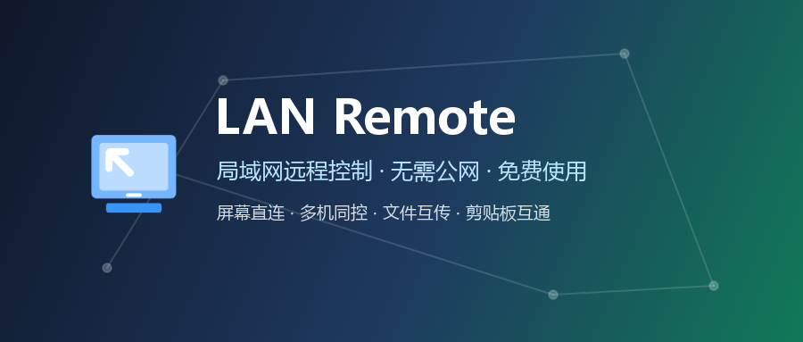
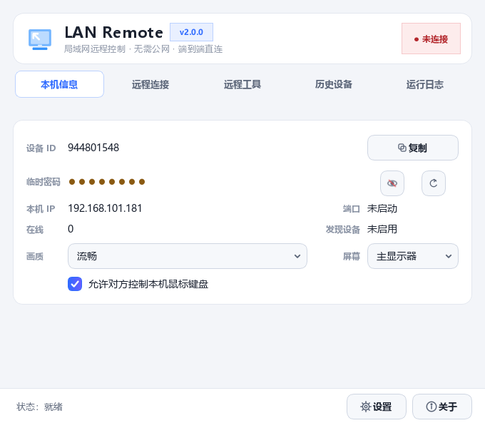
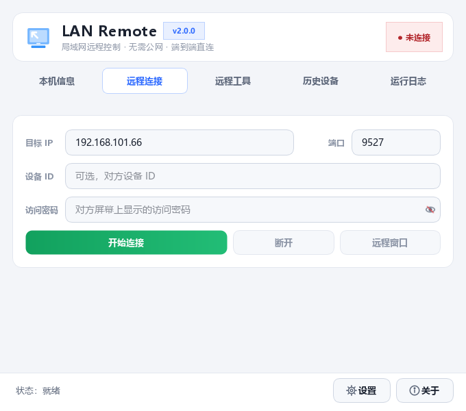
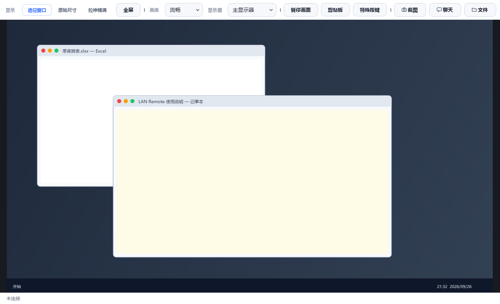
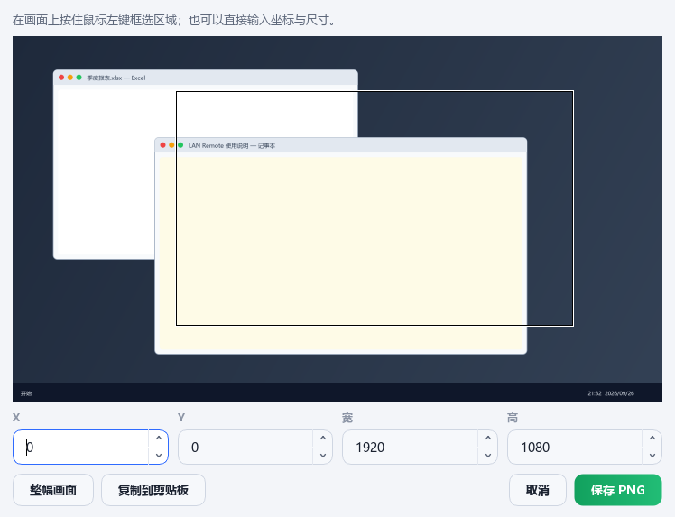
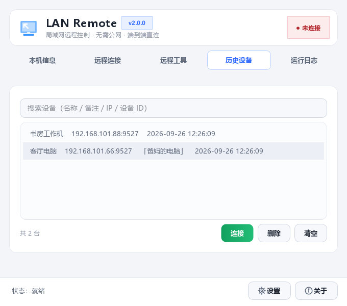
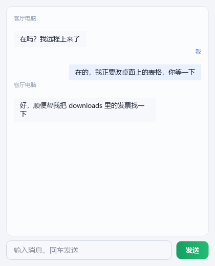
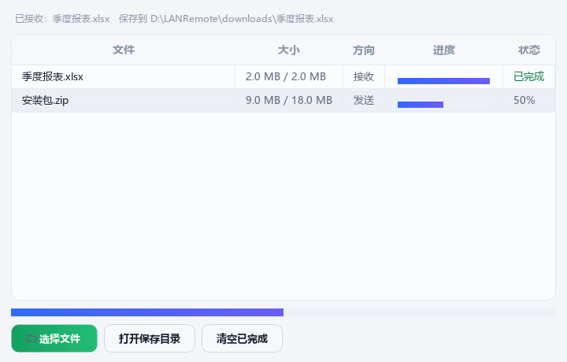

<div align="center">

# LAN Remote · 局域网远程控制

**一台电脑当被控端，其他电脑 / 手机浏览器即可实时看屏、控制鼠标键盘、传文件、聊天的局域网远程控制工具**

无需公网 · 无需服务器 · 无需注册 · 免费开源

[](LICENSE)
[](requirements.txt)
[]()
[](https://github.com/jingpanlong/LAN-Remote-Control/releases/latest)
[](https://github.com/jingpanlong/LAN-Remote-Control/releases)

[功能亮点](#-功能亮点) · [界面预览](#-界面预览) · [快速开始](#-快速开始) · [手机控制](#-手机浏览器控制新) · [安全说明](#-安全性说明) · [技术架构](#-技术架构) · [开发](#-开发与自检) · [自行打包](#-自行打包) · [常见问题](#-常见问题)

</div>



---

## 🎯 这是什么

**LAN Remote** 是一款纯局域网环境下的远程控制工具，采用「被控端 + 控制端一体」设计：同一个程序，既可以作为被控端被远程，也可以作为控制端去控制别人。

和 TeamViewer / 向日葵这类工具不同，它**不走公网、不需要服务器中转、不需要注册账号**——数据全部在同一局域网内点对点直连，延迟低、隐私好、断网也能用（只要同一个路由器）。

除了 Windows 桌面端互控，它还内置了一个**手机网页控制端**：被控端开启后生成二维码 / 访问链接，手机扫码即可用浏览器全屏远程控制电脑，支持横屏全屏、悬浮真实鼠标、中文输入、文件双向传输。

---

## ✨ 功能亮点

### 🖥 远程控制
| 功能 | 说明 |
| --- | --- |
| 实时屏幕 | 最高 60 FPS 推流，4 档画质（流畅 / 均衡 / 高清 / 极致）随时切换 |
| 鼠标控制 | 移动、左键、右键、中键、双击、滚轮、按住拖拽，坐标按实际绘制区域精确反算 |
| 键盘控制 | 全键盘按键 + 组合键（全选 / 复制 / 粘贴 / 保存 / 撤销等），支持特殊按键面板 |
| 显示模式 | 适应窗口 / 原始尺寸 1:1（带滚动条）/ 拉伸铺满，支持窗口全屏 |
| 多显示器 | 自动列出被控端显示器，可指定推流哪一块屏幕 |
| 一键截图 | 保存远端当前画面原始分辨率 PNG；支持**自定义框选区域 + 精确宽高截图** |

### 🔐 两种接入方式
- **密码模式**：填设备 ID + 访问密码（临时密码为「字母+数字」混合，可设置有效期；也可设为永不过期的固定密码）直接接入；
- **授权模式**：只填设备 ID，被控端弹出授权确认框，人工点「同意」才接入（60 秒超时自动拒绝）。

### 👥 多设备并发
同时远程**任意多台**设备，每个目标独立会话、独立画面窗口、独立聊天与文件通道，互不干扰。

### 📁 文件传输 + 💬 在线聊天
- 文件双向传输：分块发送、流式 MD5 校验、断名避让、防目录穿越，大文件也不卡界面；
- 聊天窗口：控制端与被控端实时对话，消息以气泡展示，支持托盘提醒。

### 🗂 历史设备 & 运行日志
- 历史设备：自动记录连接过的设备（设备 ID / IP / 端口 / 备注 / 收藏），支持搜索与**收藏置顶**，双击一键回填表单；
- 运行日志：实时日志面板，支持一键导出为文本或清空。

### 📱 手机浏览器控制（新）
被控端开启网页访问服务后可生成访问链接与二维码，手机浏览器扫码即用（详见下文）。

### 🎨 桌面体验
- 深浅两套主题一键切换，全局统一配色（颜色令牌集中在 `ui/theme.py`）；
- 系统托盘常驻，设备接入 / 断开 / 收到聊天或文件时托盘气泡提醒 + 提示音；
- 单实例运行（重复启动会唤醒已有窗口，不会出现多个托盘图标）；
- 五标签页主界面：本机信息 / 远程连接 / 远程工具 / 历史设备 / 运行日志。

---

## 📸 界面预览

| 本机信息 | 远程连接 |
| :---: | :---: |
|  |  |

| 远程控制（画中画窗口） | 自定义截图 |
| :---: | :---: |
|  |  |

| 历史设备 | 在线聊天 | 文件传输 |
| :---: | :---: | :---: |
|  |  |  |

---

## 🚀 快速开始

### 方式一：安装版（推荐）

到 [Releases](https://github.com/jingpanlong/LAN-Remote-Control/releases/latest) 下载 `LANRemote-Setup-x.y.z.exe`，双击安装：

- 中文安装向导，可选安装目录（默认装到当前用户目录，**无需管理员权限、不弹 UAC**）；
- 自动创建开始菜单与桌面快捷方式，并注册标准卸载程序。

> 安装到用户目录是刻意设计：程序会在自身目录下写入 `cache/`（设备记录、密钥）、`logs/`、`downloads/`，装在 `Program Files` 下会因权限不足而无法写入。

### 方式二：单文件免安装

到 [Releases](https://github.com/jingpanlong/LAN-Remote-Control/releases/latest) 下载 `LANRemote.exe`（约 120 MB，已内置 Python 运行时与全部依赖），**双击即用**，放到 U 盘里也能跑。

### 方式三：源码运行

```bash
git clone https://github.com/jingpanlong/LAN-Remote-Control.git
cd LAN-Remote-Control

python -m venv .venv
.venv\Scripts\activate

pip install -r requirements.txt
python main.py
```

环境要求：**Windows 10 / 11**，**Python 3.11+**。

### 两台电脑互控：三步搞定

1. **被控端**：启动程序 → 「本机信息」页可见**设备 ID**与**临时密码**（点小眼睛可显示明文）；
2. **控制端**：切到「远程连接」页 → 填设备 ID + 密码（或只填设备 ID 走「请求授权」）→ 点「开始连接」；
3. 连接成功后自动弹出远程画面窗口，鼠标键盘即可操作。

> 不知道对方 IP？不用填。程序通过 UDP 广播（端口 4527）自动发现局域网内的设备，只需设备 ID 即可连上。

---

## 📱 手机浏览器控制（新）

被控端程序里点「手机扫码」即可弹出访问链接与二维码：

1. 手机连接**同一个 Wi-Fi**；
2. 用微信 / 浏览器扫描二维码，或直接打开 `http://电脑IP:9528/`；
3. 输入设备 ID + 密码（或走授权模式）→ 开始控制。

手机端特性：

- **横屏全屏**：一键进入全屏并锁定横屏，画面铺满整块屏幕；
- **悬浮真实鼠标**：半透明可拖动的鼠标控件，左/右键按住即按下、松开即抬起（**支持按住左键拖拽**），中键滚轮区上下滑动，另有一键双击；
- **键盘输入**：英文数字实时逐字上屏；中文/表情走**剪贴板粘贴通道**，拼音输入法不会被打断、整段文字一个字不丢；
- **文件双向传输**：手机文件发送到电脑 `downloads/` 目录；电脑发来的文件在手机上点「保存到手机」即可下载；
- **在线聊天**：与桌面端实时对话；
- **画质切换**：流畅 / 均衡 / 高清 / 极致 四档即时生效。

> 手机端只是一个网页，通过标准 WebSocket 与被控端通信，**使用与桌面客户端完全相同的 JSON 协议**，服务端零改动即天然支持多客户端并发。

---

## 🔌 端口说明

| 端口 | 协议 | 用途 | 被占用时 |
| --- | --- | --- | --- |
| **9527** | TCP / WebSocket | 主控制通道（桌面端与手机端都连这里） | 自动向后回退 |
| **9528** | TCP / HTTP | 手机控制页 / 二维码 / 健康检查 | 自动向后回退 |
| **4527** | UDP | 局域网设备发现广播 | — |

主机防火墙需放行上述端口（首次运行 Windows 会弹窗询问，选择「允许」即可）。

---

## 🛡 安全性说明

| 机制 | 说明 |
| --- | --- |
| 局域网直连 | 不经过任何第三方服务器，数据全程在内网传输 |
| 登录鉴权 | 除登录报文外，**所有消息都要求已完成认证**；密码错误立即断开；同一连接最多尝试 5 次 |
| 密码体系 | 临时密码为「字母+数字」混合（剔除易混字符 0/O、1/l/I），可设置有效期自动刷新；也可设为固定密码（永不过期） |
| 接入确认 | 支持「授权模式」，必须被控端人工点同意才能接入，超时自动拒绝 |
| 本地加密 | 密钥材料存放于 `cache/secret.key`（Fernet），设备记录存于 `cache/remote.db`（SQLite + WAL） |
| 只看画面 | 被控端可一键关闭「允许控制本机鼠标键盘」，此时所有输入指令被服务端直接丢弃 |

⚠️ **重要**：请仅在**你拥有或已获得明确授权**的设备上使用本软件。请勿用于任何未经授权的访问、监控或控制行为。

---

## 🧩 技术架构

```
LAN-Remote-Control/
├── main.py                  # 程序入口：单实例锁 → 服务启动 → 主窗口
├── config.py                # 全局配置与持久化（settings.json）
├── build.py                 # 一键打包（PyInstaller，单文件 exe）
├── selftest.py              # 自检脚本（核心 + GUI 共 155 项）
├── LANRemote.spec           # PyInstaller 打包配置
├── installer/               # Inno Setup 安装包脚本
├── assets/                  # 图标、手机控制页模板
├── core/                    # 核心层（无界面依赖）
│   ├── protocol.py          #   协议唯一入口：Protocol / ProtocolBuilder
│   ├── server.py            #   被控端 WebSocket 服务 + 推流循环
│   ├── client.py            #   控制端连接与重连
│   ├── control.py           #   鼠标 / 键盘 / 滚轮落到操作系统
│   ├── screen.py            #   屏幕采集与缩放编码
│   ├── web_access.py        #   手机网页访问 HTTP 服务
│   ├── discovery.py         #   UDP 设备发现
│   ├── security.py          #   临时 / 固定密码体系
│   ├── file_transfer.py     #   文件传输协议
│   └── ...
├── ui/                      # PyQt6 界面层
│   ├── main_window.py       #   主窗口（五标签页 + 多会话管理）
│   ├── remote_window.py     #   远程画面窗口
│   ├── chat_window.py       #   聊天
│   ├── file_window.py       #   文件传输
│   ├── screenshot_dialog.py #   自定义截图
│   ├── theme.py / style.qss #   主题令牌与样式模板
│   └── ...
├── database/                # SQLite 历史设备
├── web/                     # 内置使用说明页
└── docs/screenshots/        # 文档配图
```

### 线程模型（重要设计）

- 所有网络 I/O 跑在**单一 asyncio 事件循环线程**（`core/loop_runner.py`）；
- Qt 主线程**只通过信号槽**与网络层通信（`ui/client_bridge.py`），绝不跨线程操作控件；
- 服务端回调（状态、聊天、文件、画质、设备上下线）都在事件循环线程触发，统一经 Qt 信号切回主线程；
- 键盘鼠标指令投递到**单线程池**顺序执行，保证事件顺序不乱且不阻塞事件循环。

### 推流三条铁律

1. 只编码**新帧**（按帧序号判别），绝不重复编码同一张图；
2. 缩放 / JPEG / Base64 编码全部丢进线程池，事件循环只负责收发；
3. 上一帧没编完就**丢弃当前帧**——宁可掉帧，不堆队列。

### 通信协议

统一 JSON 报文：`{version, type, session, timestamp, data}`，消息类型由 `core/protocol.py` 集中定义，新增消息一律通过 `ProtocolBuilder` 构造。

| 分类 | 消息类型 |
| --- | --- |
| 会话 | `login` / `login_success` / `login_failed` / `heartbeat` / `info` / `error` |
| 画面 | `screen` / `screen_request` / `screen_stop` / `quality_set` / `quality_state` / `monitor_list*` |
| 控制 | `mouse_move` / `mouse_click` / `mouse_scroll` / `keyboard` |
| 剪贴板 | `clipboard` / `clipboard_push` / `clipboard_fetch` / `clipboard_data` |
| 聊天 | `chat` |
| 文件 | `file_info` / `file_data` / `file_finish` / `file_cancel` / `file_progress` |

---

## 🛠 开发与自检

项目自带一套覆盖核心链路与界面行为的自检脚本，**改动后必跑**：

```bash
python selftest.py          # 全部 155 项（核心 56 + GUI 99）
python selftest.py --core   # 仅核心链路（无需图形界面）
python selftest.py --gui    # 仅界面（offscreen 模式）
```

退出码为 `0` 表示全部通过。自检会使用临时数据库与临时设置，**不会污染你自己的设备记录与配置**。

---

## 📦 自行打包

### 1. 单文件 exe

```bash
python build.py
# 产出：dist/LANRemote.exe（约 120 MB，内置 Python 运行时）
```

打包配置在 `LANRemote.spec`，其中有三条不可省的规则（都是踩过的坑）：

1. **必须排除多余 Qt 绑定**（PyQt5 / PySide2 / PySide6 / qtpy）——本机多绑定共存时会导致构建冲突；
2. **websockets 17.x 必须显式收集子模块**——新版采用 PEP 562 懒加载，静态分析追踪不到；
3. **numpy 需补 `_multiarray_tests`**——残留的 dist-info 会让 hook 误判版本。

### 2. 安装版 exe（Inno Setup）

先装 [Inno Setup 6](https://jrsoftware.org/isdl.php)，然后：

```bash
"C:\Program Files (x86)\Inno Setup 6\ISCC.exe" installer\LANRemote.iss
# 产出：dist/LANRemote-Setup-x.y.z.exe
```

安装脚本位于 `installer/LANRemote.iss`（含简体中文 / English 双语向导、桌面快捷方式、标准卸载程序）。其中 `installer/ChineseSimplified.isl` 来自 [Inno Setup 社区翻译](https://jrsoftware.org/files/istrans/)，如不需要中文向导可删除该文件并移除脚本中的 `chinese` 语言行。

---

## ❓ 常见问题

<details>
<summary><b>连接提示「被控端未在线」？</b></summary>

确认两台设备在**同一局域网**、被控端程序已启动、Windows 防火墙已放行 9527 / 4527 端口。若被控端端口被占用会自动回退，控制端通过设备发现可自动对上。
</details>

<details>
<summary><b>提示「接入被拒绝」？</b></summary>

密码不正确，或被控端开启了「授权模式」而人工拒绝了请求。请核对临时密码（临时密码会按有效期自动刷新，过期需重新查看）。
</details>

<details>
<summary><b>远程窗口里双击不灵？</b></summary>

已在 v2.0 修复（Qt 会把第二次物理按下派发为 `MouseButtonDblClick`，需按按下事件处理）。请使用最新版本。
</details>

<details>
<summary><b>手机端中文输入打不进去？</b></summary>

被控端的键盘执行层只支持 ASCII 字符与按键名，中文必须走剪贴板通道：手机端在输入框里正常拼音打字（不打断输入法），然后点「📤 发送到电脑」，程序会把整段文字同步到被控端剪贴板并自动 `Ctrl+V` 粘贴——一个字都不会丢。
</details>

<details>
<summary><b>画面卡顿 / 帧率上不去？</b></summary>

推流帧率受分辨率影响很大。1080P 单帧编码约 15~25 ms，60 FPS 只有 16.6 ms 预算，建议高帧率配合「流畅」档（1280 宽）使用；局域网带宽不足时优先降画质档位。
</details>

<details>
<summary><b>数据存在哪儿？卸载会残留吗？</b></summary>

运行时数据写在程序所在目录：`cache/`（设备记录、密钥、设置）、`logs/`（运行日志）、`downloads/`（接收的文件）。安装版卸载时会一并清理这些目录。
</details>

---

## 🤝 参与贡献

欢迎提交 Issue 与 Pull Request。提交前请确保：

- `python selftest.py` 全绿；
- 涉及协议改动时同步更新 `core/protocol.py` 与自检用例；
- 界面颜色不得硬编码十六进制色值，统一走 `ui/theme.py` 设计令牌。

---

## 📄 开源许可

本项目基于 [MIT License](LICENSE) 开源，可自由使用、修改与分发（请保留版权声明）。

## ⚠️ 免责声明

本软件仅用于**合法授权的远程运维与技术支持**场景。使用者应确保对受控设备拥有合法操作权限，因违规使用产生的一切后果由使用者自行承担。

---

<div align="center">

**如果这个项目对你有帮助，欢迎点一个 ⭐ Star 支持一下**

Made with ❤️ by 景同志

</div>
