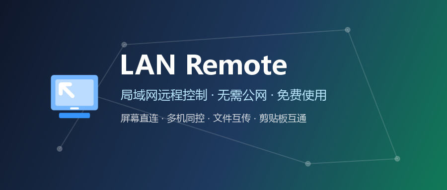
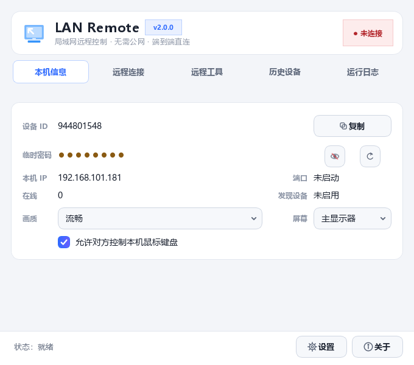
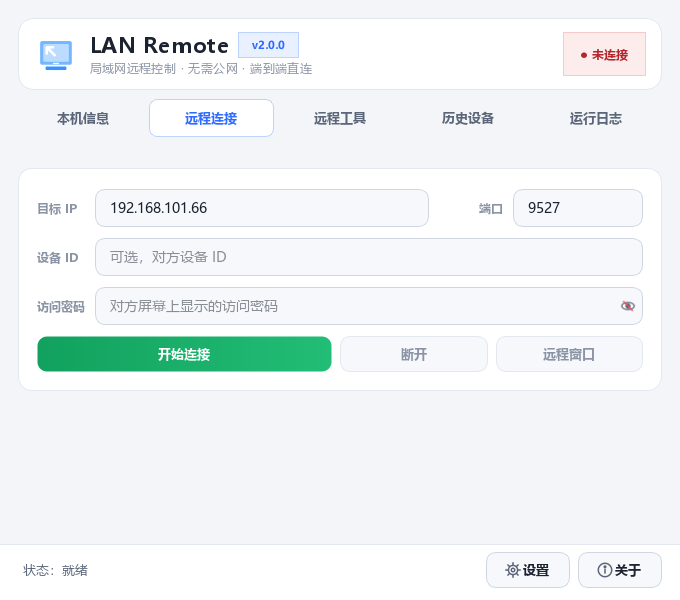
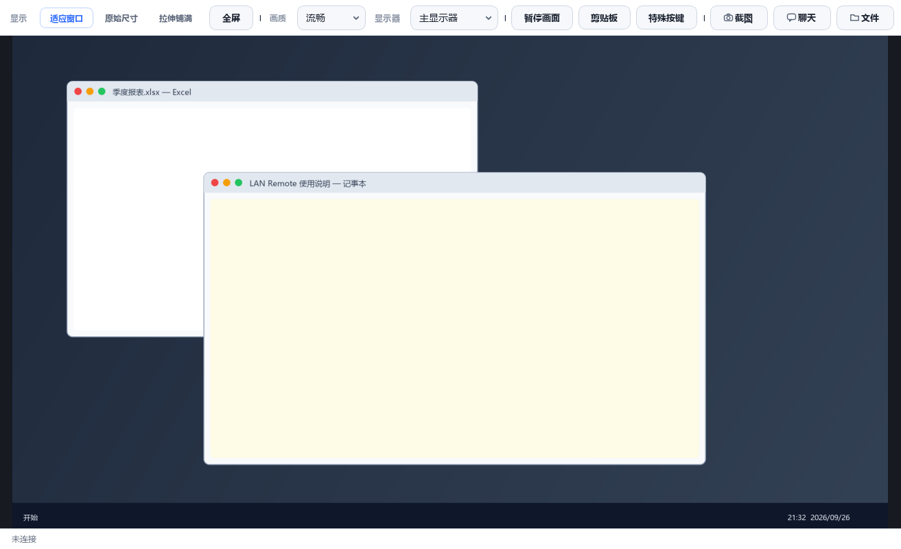
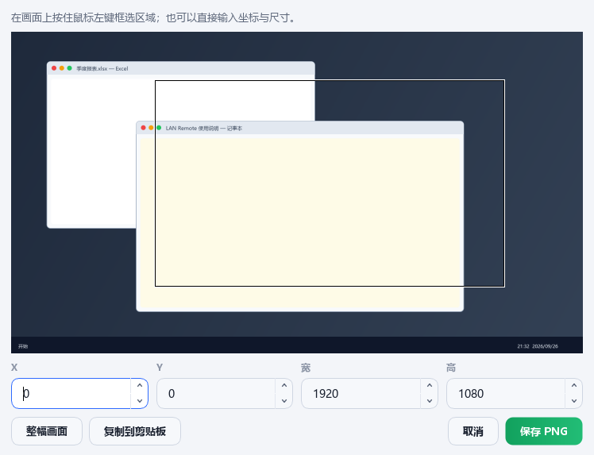
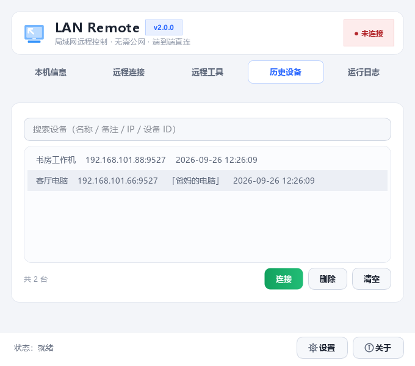
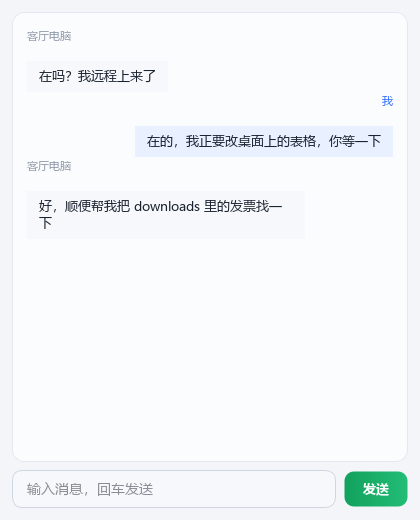
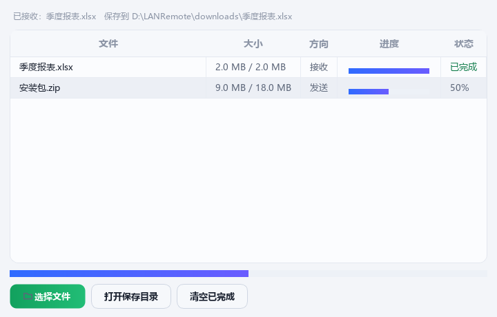

<div align="center">

# LAN Remote

**A LAN remote-control tool where one PC acts as the controlled host while other PCs or phones control it via a browser in real time — view the screen, control mouse and keyboard, transfer files, and chat.**

No public internet · No server · No registration · Free and open source

[](LICENSE)
[](requirements.txt)
[]()
[](https://github.com/jingpanlong/LAN-Remote-Control/releases/latest)
[](https://github.com/jingpanlong/LAN-Remote-Control/releases)

[Highlights](#-highlights) · [Screenshots](#-screenshots) · [Quick Start](#-quick-start) · [Phone Control](#-phone-browser-control-new) · [Security](#-security) · [Architecture](#-architecture) · [Development](#-development--self-test) · [Packaging](#-packaging) · [FAQ](#-faq)

</div>



---

## 🎯 What is this

**LAN Remote** is a pure-LAN remote-control tool with a "controlled host + controller, all-in-one" design: the same program can act as a controlled host (remotely operated) or as a controller (operating others).

Unlike TeamViewer / Sunlogin, it **does not use the public internet, requires no relay server, and needs no account registration** — data travels peer-to-peer directly within the same LAN, giving low latency, good privacy, and operation even when the internet is down (as long as you share a router).

Beyond Windows desktop-to-desktop control, it has a built-in **phone web controller**: once the host enables web access, it generates a QR code / access link, and your phone scans it to control the PC full-screen from a browser — supporting landscape full-screen, a floating real mouse, Chinese input, and bidirectional file transfer.

---

## ✨ Highlights

### 🖥 Remote control

| Feature | Description |
| --- | --- |
| Live screen | Streaming up to 60 FPS, 4 quality levels (Smooth / Balanced / HD / Ultimate) switchable at any time |
| Mouse control | Move, left/right/middle click, double-click, wheel, press-and-drag — coordinates precisely reverse-mapped to the drawn area |
| Keyboard control | Full keyboard and shortcuts (select-all / copy / paste / save / undo, etc.), with a special-keys panel |
| Display modes | Fit to window / original 1:1 (scrollable) / stretch to fill, plus window full-screen |
| Multi-monitor | Lists the host's monitors automatically; choose which screen to stream |
| One-click screenshot | Save the remote screen at native resolution as PNG; supports **custom region selection + exact width/height capture** |

### 🔐 Two access modes

- **Password mode**: enter device ID + access password (a temporary password is a mixed "letters + digits" value with an optional expiry; or set a never-expiring fixed password) to connect directly;
- **Authorization mode**: enter only the device ID; the host pops up an authorization dialog and a human must click "Approve" to connect (auto-rejected after a 60-second timeout).

### 👥 Concurrent multi-device

Remotely control **any number** of devices at once — each target gets an independent session, independent screen window, and independent chat and file channels, with no interference.

### 📁 File transfer + 💬 Chat

- Bidirectional file transfer: chunked sending, streaming MD5 verification, name-collision avoidance, directory-traversal protection — large files won't freeze the UI;
- Chat window: real-time conversation between controller and host, messages shown as bubbles, with tray notifications.

### 🗂 History devices & run logs

- History devices: automatically records connected devices (device ID / IP / port / note / favorite), with search and **favorite pinning**; double-click to auto-fill the form;
- Run logs: real-time log panel, with one-click export to text or clear.

### 📱 Phone browser control (new)

After the host enables the web access service, it generates an access link and QR code; your phone scans to use it (see below).

### 🎨 Desktop experience

- Light & dark themes switchable in one click, with globally consistent colors (color tokens centralized in `ui/theme.py`);
- Persistent system tray; tray bubble + sound alert on device connect / disconnect / incoming chat or file;
- Single-instance (re-launching wakes the existing window; no duplicate tray icons);
- Five-tab main UI: local info / remote connect / remote tools / history devices / run logs.

---

## 📸 Screenshots

| Local info | Remote connect |
| :---: | :---: |
|  |  |

| Remote control (picture-in-picture window) | Custom screenshot |
| :---: | :---: |
|  |  |

| History devices | Chat | File transfer |
| :---: | :---: | :---: |
|  |  |  |

---

## 🚀 Quick Start

### Option 1: Installer (recommended)

Download `LANRemote-Setup-x.y.z.exe` from [Releases](https://github.com/jingpanlong/LAN-Remote-Control/releases/latest) and double-click to install:

- Chinese installation wizard with an optional install directory (defaults to the current user's folder — **no admin rights, no UAC prompt**);
- Auto-creates Start Menu and desktop shortcuts, and registers a standard uninstaller.

> Installing to the user folder is intentional: the program writes `cache/` (device records, keys), `logs/`, and `downloads/` inside its own directory; installing under `Program Files` would fail to write due to insufficient permissions.

### Option 2: Single-file, no install

Download `LANRemote.exe` from [Releases](https://github.com/jingpanlong/LAN-Remote-Control/releases/latest) (~120 MB, with Python runtime and all dependencies bundled) — **double-click to run**, works from a USB drive too.

### Option 3: Run from source

```bash
git clone https://github.com/jingpanlong/LAN-Remote-Control.git
cd LAN-Remote-Control

python -m venv .venv
.venv\Scripts\activate

pip install -r requirements.txt
python main.py
```

Requirements: **Windows 10 / 11**, **Python 3.11+**.

### Two PCs controlling each other: three steps

1. **Host**: launch the program → the "Local Info" page shows the **device ID** and **temporary password** (click the eye icon to reveal);
2. **Controller**: switch to the "Remote Connect" page → enter device ID + password (or enter only the device ID to use "request authorization") → click "Start Connection";
3. On success, the remote screen window pops up automatically and you can operate the mouse and keyboard.

> Don't know the other PC's IP? You don't need it. The program auto-discovers LAN devices via UDP broadcast (port 4527); only the device ID is needed to connect.

---

## 📱 Phone browser control (new)

Click "Phone Scan" in the host program to pop up the access link and QR code:

1. Connect your phone to the **same Wi-Fi**;
2. Scan the QR code with WeChat / a browser, or open `http://<PC-IP>:9528/` directly;
3. Enter device ID + password (or use authorization mode) → start controlling.

Phone-side features:

- **Landscape full-screen**: one tap enters full-screen and locks landscape, filling the whole screen;
- **Floating real mouse**: a semi-transparent draggable mouse control — press-and-hold left/right to press, release to lift (supports hold-left-drag), a middle-wheel area for up/down scroll, and a one-tap double-click;
- **Keyboard input**: English/digits type through character-by-character in real time; Chinese/emoji go through the **clipboard paste channel**, so the pinyin IME is never interrupted and the entire text is delivered losslessly;
- **Bidirectional file transfer**: phone files are sent to the PC `downloads/` folder; files sent from the PC can be saved to the phone by tapping "Save to Phone";
- **Chat**: real-time conversation with the desktop client;
- **Quality switch**: Smooth / Balanced / HD / Ultimate, taking effect instantly.

> The phone side is just a web page that talks to the host over standard WebSocket, **using the exact same JSON protocol as the desktop client** — the server needs zero changes and naturally supports multiple concurrent clients.

---

## 🔌 Ports

| Port | Protocol | Purpose | If occupied |
| --- | --- | --- | --- |
| **9527** | TCP / WebSocket | Main control channel (desktops and phones connect here) | Auto-falls back |
| **9528** | TCP / HTTP | Phone control page / QR code / health check | Auto-falls back |
| **4527** | UDP | LAN device-discovery broadcast | — |

The host firewall must allow these ports (Windows prompts on first run — choose "Allow").

---

## 🛡 Security

| Mechanism | Description |
| --- | --- |
| LAN direct connection | No third-party server involved; data travels entirely within the intranet |
| Login auth | Except the login packet, **every message requires completed authentication**; wrong password disconnects immediately; max 5 attempts per connection |
| Password system | Temporary password is mixed "letters + digits" (excluding ambiguous 0/O, 1/l/I), with optional auto-refresh expiry; or set a fixed (never-expiring) password |
| Access confirmation | Supports "authorization mode" — the host must manually approve before connecting; auto-rejected on timeout |
| Local encryption | Key material in `cache/secret.key` (Fernet); device records in `cache/remote.db` (SQLite + WAL) |
| View-only | The host can disable "allow controlling my mouse/keyboard" in one click; all input commands are then dropped by the server |

⚠️ **Important**: use this software only on devices you own or are explicitly authorized to operate. Do not use it for any unauthorized access, monitoring, or control.

---

## 🧩 Architecture

```
LAN-Remote-Control/
├── main.py                  # Entry point: single-instance lock → start service → main window
├── config.py                # Global config & persistence (settings.json)
├── build.py                 # One-click packaging (PyInstaller, single-file exe)
├── selftest.py              # Self-test script (core + GUI, 155 cases)
├── LANRemote.spec           # PyInstaller packaging config
├── installer/               # Inno Setup installer script
├── assets/                  # Icons, phone control page template
├── core/                    # Core layer (no UI dependency)
│   ├── protocol.py          #   Sole protocol entry: Protocol / ProtocolBuilder
│   ├── server.py            #   Host WebSocket service + streaming loop
│   ├── client.py            #   Controller connection & reconnection
│   ├── control.py           #   Mouse / keyboard / wheel applied to OS
│   ├── screen.py            #   Screen capture, scaling & encoding
│   ├── web_access.py        #   Phone web-access HTTP service
│   ├── discovery.py         #   UDP device discovery
│   ├── security.py          #   Temporary / fixed password system
│   ├── file_transfer.py     #   File transfer protocol
│   └── ...
├── ui/                      # PyQt6 UI layer
│   ├── main_window.py       #   Main window (five tabs + multi-session management)
│   ├── remote_window.py     #   Remote screen window
│   ├── chat_window.py       #   Chat
│   ├── file_window.py       #   File transfer
│   ├── screenshot_dialog.py #   Custom screenshot
│   ├── theme.py / style.qss #   Theme tokens & style templates
│   └── ...
├── database/                # SQLite history devices
├── web/                     # Built-in usage page
└── docs/screenshots/        # Documentation images
```

### Threading model (important design)

- All network I/O runs in a **single asyncio event-loop thread** (`core/loop_runner.py`);
- The Qt main thread communicates with the network layer **only via signals/slots** (`ui/client_bridge.py`) — never touching widgets across threads;
- Server callbacks (status, chat, file, quality, device online/offline) fire in the event-loop thread and are uniformly switched back to the main thread via Qt signals;
- Keyboard/mouse commands are dispatched to a **single-threaded pool** and executed sequentially, preserving event order without blocking the event loop.

### Three rules of streaming

1. Only encode **new frames** (by frame sequence number) — never re-encode the same image;
2. Scaling / JPEG / Base64 encoding all go into the thread pool; the event loop only sends and receives;
3. If the previous frame isn't done, **drop the current frame** — rather drop frames than build a queue.

### Communication protocol

Unified JSON packets: `{version, type, session, timestamp, data}`, with message types centralized in `core/protocol.py`; new messages are always built via `ProtocolBuilder`.

| Category | Message types |
| --- | --- |
| Session | `login` / `login_success` / `login_failed` / `heartbeat` / `info` / `error` |
| Screen | `screen` / `screen_request` / `screen_stop` / `quality_set` / `quality_state` / `monitor_list*` |
| Control | `mouse_move` / `mouse_click` / `mouse_scroll` / `keyboard` |
| Clipboard | `clipboard` / `clipboard_push` / `clipboard_fetch` / `clipboard_data` |
| Chat | `chat` |
| File | `file_info` / `file_data` / `file_finish` / `file_cancel` / `file_progress` |

---

## 🛠 Development & Self-test

The project ships a self-test suite covering core flows and UI behavior — **run it after any change**:

```bash
python selftest.py          # All 155 cases (56 core + 99 GUI)
python selftest.py --core   # Core flows only (no GUI needed)
python selftest.py --gui    # UI only (offscreen mode)
```

Exit code `0` means all passed. The self-test uses temporary databases and settings and **will not pollute your own device records or config**.

---

## 📦 Packaging

### 1. Single-file exe

```bash
python build.py
# Output: dist/LANRemote.exe (~120 MB, Python runtime bundled)
```

The packaging config is in `LANRemote.spec`, which has three non-negotiable rules (hard-won lessons):

1. **Exclude extra Qt bindings** (PyQt5 / PySide2 / PySide6 / qtpy) — coexisting bindings cause build conflicts;
2. **websockets 17.x must explicitly collect submodules** — the new PEP 562 lazy loading is invisible to static analysis;
3. **numpy needs `_multiarray_tests` patched in** — leftover dist-info makes the hook misjudge the version.

### 2. Installer exe (Inno Setup)

Install [Inno Setup 6](https://jrsoftware.org/isdl.php) first, then:

```bash
"C:\Program Files (x86)\Inno Setup 6\ISCC.exe" installer\LANRemote.iss
# Output: dist/LANRemote-Setup-x.y.z.exe
```

The install script is at `installer/LANRemote.iss` (with Simplified Chinese / English bilingual wizard, desktop shortcuts, and a standard uninstaller). `installer/ChineseSimplified.isl` comes from the [Inno Setup community translations](https://jrsoftware.org/files/istrans/); if you don't need the Chinese wizard, delete that file and remove the `chinese` language line from the script.

---

## ❓ FAQ

<details>
<summary><b>Connection says "host is offline"?</b></summary>

Confirm both devices are on the **same LAN**, the host program is running, and Windows Firewall allows ports 9527 / 4527. If the host port is occupied it auto-falls back, and the controller can auto-match via device discovery.
</details>

<details>
<summary><b>Prompt "access denied"?</b></summary>

The password is wrong, or the host enabled "authorization mode" and a human rejected the request. Check the temporary password (it auto-refreshes by expiry; re-check after it expires).
</details>

<details>
<summary><b>Double-click doesn't work in the remote window?</b></summary>

Fixed in v2.0 (Qt dispatches the second physical press as `MouseButtonDblClick`, which must be handled as a press event). Please use the latest version.
</details>

<details>
<summary><b>Can't type Chinese on the phone?</b></summary>

The host's keyboard-execution layer supports only ASCII characters and key names; Chinese must go through the clipboard channel: type pinyin normally in the phone input box (without interrupting the IME), then tap "📤 Send to PC" — the program syncs the whole text to the host clipboard and auto `Ctrl+V` pastes it, losslessly.
</details>

<details>
<summary><b>Screen lags / low frame rate?</b></summary>

Streaming frame rate is heavily affected by resolution. A single 1080p frame encodes in ~15–25 ms, while 60 FPS leaves only 16.6 ms — pair high frame rates with the "Smooth" level (1280 width); when LAN bandwidth is insufficient, lower the quality level first.
</details>

<details>
<summary><b>Where is data stored? Leftover after uninstall?</b></summary>

Runtime data is written in the program's directory: `cache/` (device records, keys, settings), `logs/` (run logs), `downloads/` (received files). The installer cleans these directories on uninstall.
</details>

---

## 🤝 Contributing

Issues and Pull Requests are welcome. Before submitting, please ensure:

- `python selftest.py` is all green;
- Protocol changes also update `core/protocol.py` and the self-test cases;
- UI colors must not be hardcoded hex values — use the design tokens in `ui/theme.py`.

---

## 📄 License

This project is open-sourced under the [MIT License](LICENSE) — free to use, modify, and distribute (please retain the copyright notice).

## ⚠️ Disclaimer

This software is intended only for **legally authorized remote operations and technical support**. Users must ensure they have legal permission to operate the controlled devices; all consequences of misuse are borne by the user.

---

<div align="center">

**If this project helps you, a ⭐ Star would be greatly appreciated**

Made with ❤️ by 景同志

</div>
